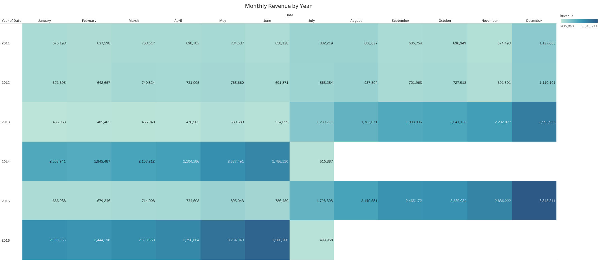
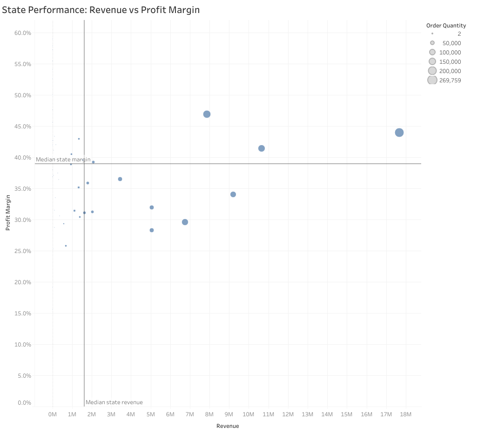

# Retail-Sales-Performance-Profitability-Analysis

## Executive Summary

A multi-market retail business needs to understand how effectively it generates revenue and maintains profitability across its products, markets and customer segments.

This project investigates retail sales performance using transaction data covering six countries from January 2011 to July 2016. The analysis examines revenue generation, product performance, geographical differences, customer segments and changes in profitability over time.

The business recorded approximately 85.27 million in revenue and 32.22 million in profit, representing an overall profit margin of approximately 37.8%.

As the Data Analyst in this project, my objective is to identify the factors contributing to business performance, highlight areas requiring management attention and translate the findings into practical recommendations.

## Business Context

The business operates across six international markets: the United States, Australia, the United Kingdom, Germany, France and Canada. Its product portfolio includes three main categories: Bikes, Accessories and Clothing.

Operating across different markets and product categories creates a need to understand where sales are generated, which products contribute most to profitability and how customer purchasing patterns vary.

Although overall sales provide an indication of business performance, revenue alone does not explain whether the business is generating sustainable profit or which areas deserve greater management attention.

Management therefore needs a clearer view of performance across geographical markets, products, customers and time periods to support better commercial decisions.

## Business Problem

The retailer operates across multiple countries and product categories, but overall sales figures alone do not provide enough information to understand its commercial performance.

Management needs to identify which markets and products generate the greatest revenue and profit, whether profitability is consistent across geographical regions, and how performance changes over time.

Without a clear understanding of these differences, it becomes difficult to identify underperforming areas, recognise growth opportunities and prioritise business resources.

As the Data Analyst, I aim to investigate these performance differences and provide insights that can support more informed business decisions.

## Project Objectives

- Evaluate overall sales performance using revenue, profit and profit margin.
- Identify the countries and regions contributing most to revenue and profitability.
- Assess product category and individual product performance.
- Examine changes in revenue, costs and profitability over time.
- Understand sales contributions across different age groups and genders.
- Translate analytical findings into practical business recommendations.

## Business Questions & Key Performance Indicators

The analysis is guided by the following business questions:

| Business Question | Supporting Metrics | Business Purpose |
|---|---|---|
| How is the business performing overall? | Revenue, Profit, Profit Margin, Units Sold | Evaluate overall commercial performance. |
| Which markets contribute most to business performance? | Revenue, Profit, Profit Margin by Country and State | Identify strong markets and geographical differences. |
| Which products drive revenue and profitability? | Revenue and Profit by Category, Subcategory and Product | Understand product contributions and identify opportunities. |
| How has business performance changed over time? | Monthly Revenue, Cost, Profit and Profit Margin | Identify trends and changes in financial performance. |
| Which customer segments contribute most to sales? | Revenue by Age Group and Gender | Understand differences in customer sales contributions. |

### North Star Metrics

The three primary measures used to evaluate business performance are:

- **Revenue:** The total value of sales generated.
- **Profit:** Revenue remaining after deducting recorded costs.
- **Profit Margin:** The proportion of revenue retained as profit, calculated as Profit ÷ Revenue × 100.

Supporting KPIs, including units sold and cost, provide additional context for understanding sales volume and financial performance.

## Visual Analysis

### Monthly Revenue by Year

### Revenue Accelerated in the Second Half of 2013 and 2015, Reaching a Record 3.85 Million in December 2015

The monthly revenue heatmap reveals substantial differences in sales performance across the analysed years, with particularly strong revenue growth during the second half of 2013 and 2015.

In 2013, monthly revenue increased from **1.23 million in July to 3.00 million in December**. A similar pattern occurred in 2015, when revenue rose from **666,938 in January to 3.85 million in December**, the highest monthly revenue recorded in the dataset.

December also recorded relatively strong revenue in the other complete years displayed, reaching 1.13 million in 2011 and 1.11 million in 2012.

However, this growth pattern was not consistent throughout the dataset. In 2014, revenue was relatively high during the first six months, reaching 2.79 million in June, before dropping to 516,887 in July. Revenue increased again in the following year, particularly during the second half of 2015.

**Business Insight**

The repeated increase in December revenue across the complete years suggests that year-end sales periods may be important contributors to overall business performance. The substantial increases observed during the second half of 2013 and 2015 also highlight the need to understand what drove these changes rather than assuming they were caused by seasonal demand alone.

**So What?**

Management could investigate the sales activities, product performance and market contributions associated with these high-revenue periods. Understanding the factors behind these increases could help improve inventory planning, promotional timing and resource allocation during important sales periods.

### Revenue by Country

### The United States and Australia Generate Nearly 58% of Total Revenue

The geographical revenue analysis reveals a significant concentration of sales in two markets: the United States and Australia.

The **United States leads with 27.98 million in revenue**, contributing approximately **32.8%** of total business revenue. Australia follows with **21.30 million**, representing approximately **25.0%**. Combined, these two markets account for approximately **57.8% of total revenue**.

The remaining four countries contribute considerably less. The United Kingdom generates 10.65 million, followed by Germany at 8.98 million, France at 8.43 million and Canada at 7.94 million.

The difference between the highest and lowest performing markets is substantial. Revenue from the United States is approximately **3.5 times higher than Canada's**.

**Business Insight**

The revenue distribution indicates that the retailer's sales performance is concentrated in the United States and Australia. While these markets provide a strong revenue base, the smaller contributions from the other four countries highlight differences in geographical sales performance. However, revenue alone does not establish which markets are more profitable.

**So What?**

Management should continue monitoring the United States and Australian markets because changes in their sales performance could have a considerable effect on overall revenue. At the same time, the business could investigate growth opportunities in the United Kingdom, Germany, France and Canada by examining regional demand, product preferences and profitability before making expansion or investment decisions.

### Revenue vs Profit Margin by State

### High-Revenue States Do Not Always Deliver the Highest Profit Margins

The state-level performance analysis compares revenue and profit margin to evaluate whether the regions generating the highest sales are also retaining a greater proportion of revenue as profit.

A four-quadrant scatter plot was used to examine three dimensions simultaneously: revenue, profit margin and order quantity. Median benchmarks of approximately **1.7 million in revenue** and **39% profit margin** divide the states into four performance groups.

The analysis highlights an important difference between sales scale and profitability. The highest-revenue state generated approximately **17.6 million in revenue**, with a profit margin of around **44%** and an order volume of approximately **270,000 units**.

However, another high-volume state generated approximately **7.9 million in revenue** while achieving a profit margin of around **47%**, demonstrating that a region with lower revenue can retain a greater proportion of its sales as profit.

In contrast, several states generating between **5 million and 9.2 million in revenue** recorded profit margins below 35%, indicating that relatively strong sales do not necessarily translate into equally strong profitability.

**Business Insight**

The findings reveal differences in how effectively geographical markets convert revenue into profit. Some high-revenue states combine substantial sales volume with healthy margins, while other regions generate considerable revenue but retain a smaller proportion as profit. This suggests that evaluating geographical performance through revenue alone could overlook important differences in profitability.

**So What?**

Management should investigate the product mix, pricing and cost structures of high-revenue, lower-margin states to identify opportunities for improving profitability. The higher-margin state could also provide a useful comparison for understanding differences in product and sales performance. These investigations should take place before assuming that increasing sales volume will automatically improve financial performance.

### Product Performance

#### Bikes Dominate Revenue, but Product Rankings Reveal Different Profit Contributors

<!-- Top Image: Full Width -->

  

<!-- Bottom Two Images: Side by Side (Left and Right) -->
<table>
  <tr>
    <td width="50%" align="center">
      
       
      <b>Top 5 Products by Revenue</b>
    </td>
    <td width="50%" align="center">
      
       
      <b>Top 5 Products by Profit</b>
    </td>
  </tr>
</table>

Bikes account for the largest share of product revenue, generating 61.78M (72.5%) of total revenue, followed by Accessories at 15.12M (17.7%) and Clothing at 8.37M (9.8%). This indicates that the business relies heavily on its bicycle product range to generate sales.

At the individual product level, Road-150 Red, 62 is the highest revenue-generating product, contributing approximately 3.83M. However, the profit ranking tells a different story. Mountain-200 Black, 38 ranks first with approximately 1.31M in profit, while Road-150 Red, 62 ranks second with 1.24M. The Mountain-200 series also occupies three of the five highest-profit positions. Notably, Sport-100 Helmet, Red ranks fourth, contributing approximately 1.19M in profit.

These differences show why revenue alone is not enough to evaluate product performance. A product generating the highest sales value does not necessarily contribute the highest profit. The strong profit contribution from several Mountain-200 variants and the Sport-100 Helmet also highlights the importance of evaluating both bicycle and accessory performance.

**Business Recommendations**
- Maintain close attention to stock availability and profitability for leading bicycle models, particularly the Mountain-200 variants.
- Review product costs and profit margins to understand differences between high-revenue and high-profit products.
- Explore targeted bicycle-and-helmet bundle offers to encourage accessory purchases.
- Evaluate product performance using both revenue and profit when making inventory and marketing decisions.